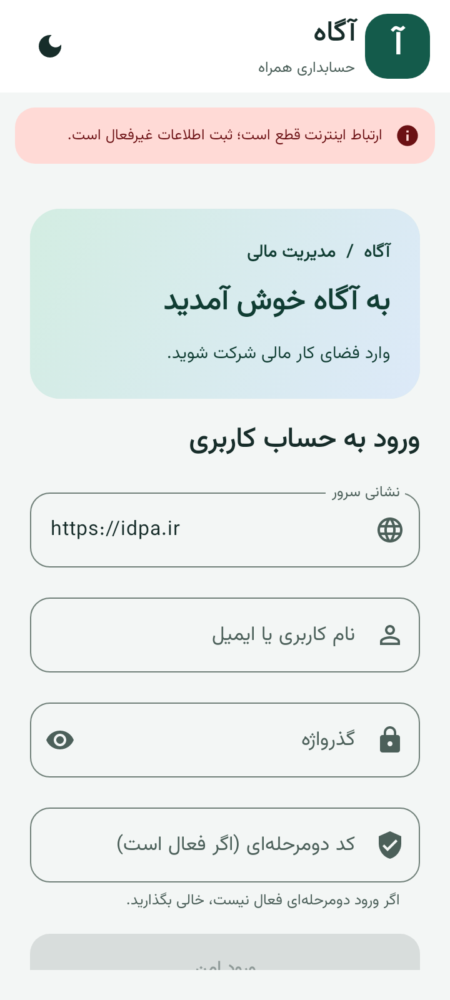
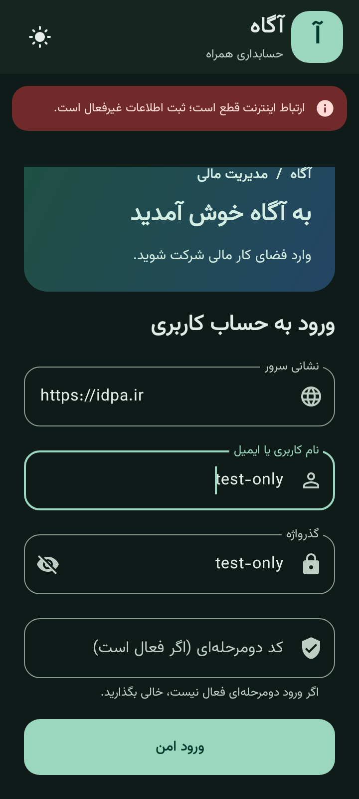
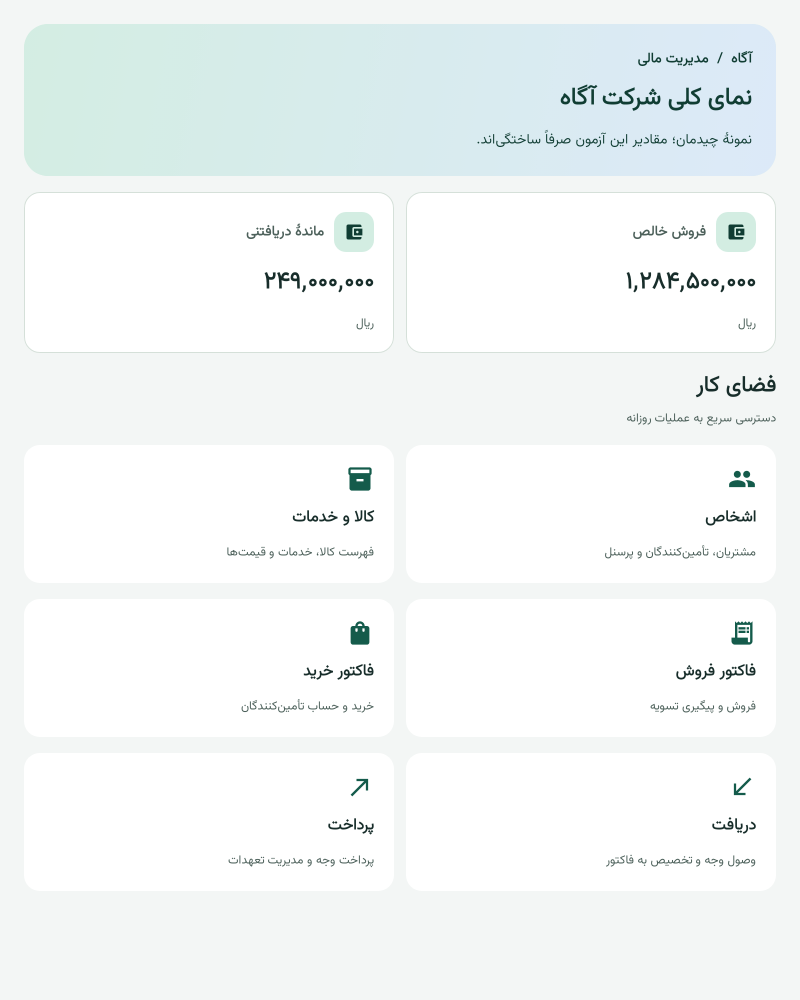
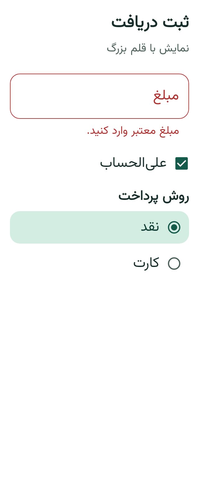
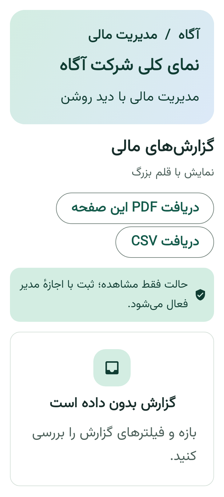

# تصاویر بازطراحی رابط آگاه

این‌ها خروجی رندر واقعی Compose در آزمون JVM هستند. ورود از خود اپ رندر شده است؛ نمونه‌های داشبورد و فرم از اجزای واقعی و با دادهٔ ساختگی آزمون‌اند. تصویر محیط تست جایگزین تست روی گوشی واقعی نیست. پیام قطع ارتباط در صفحهٔ ورود مربوط به شبکهٔ محیط آزمون است.

## ورود، حالت روشن

## ورود، حالت تیره

## نمونهٔ چیدمان اجزای داشبورد در تبلت

## عرض کم و قلم بزرگ

